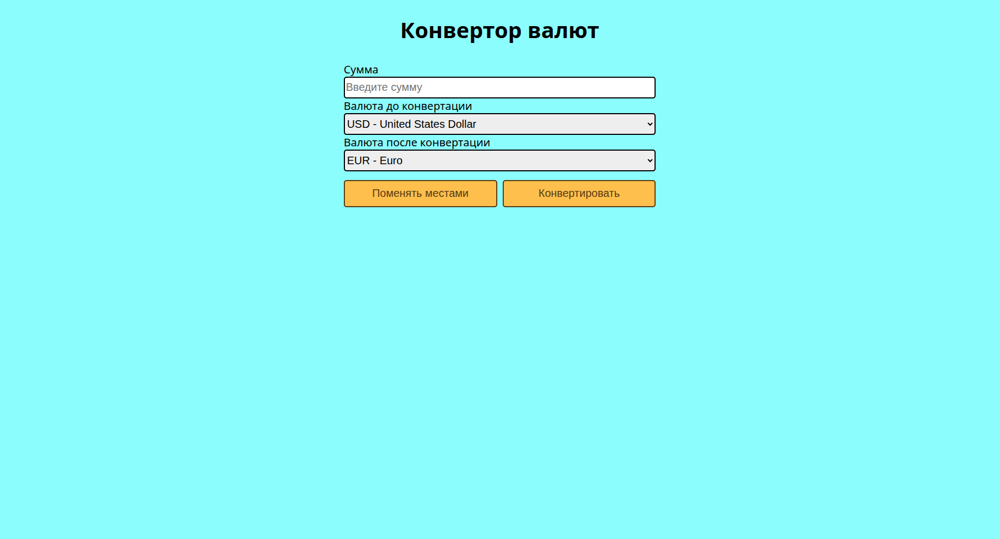

## Currency Converter

Веб-приложение для конвертации валют. Работает в браузере, без бэкенда. Курсы берутся с публичного API [frankfurter.dev](https://frankfurter.dev).

## Возможности

- Конвертация между любыми поддерживаемыми валютами
- Автоматическая загрузка списка валют с актуальными названиями
- Кнопка «Поменять местами» для быстрой смены направления конвертации
- Валидация ввода: только цифры, до 10 знаков
- Подсветка ошибок: одинаковая валюта, пустое поле, недоступный API
- Адаптивный интерфейс без внешних библиотек

## Стек

- **HTML5** — структура
- **CSS3** — стили (без фреймворков)
- **JavaScript (ES6+)** — логика, `fetch` для запросов к API

## Структура проекта

```
convert/
├── index.html    # Разметка страницы
├── style.css     # Стили
├── script.js     # Логика конвертации
└── README.md
```

## Запуск

Никаких зависимостей и сборки не требуется — это статический сайт.

### Вариант 1: открыть файл напрямую

Дважды кликни `index.html` в файловом менеджере.

⚠️ **Возможная проблема:** при открытии через `file://` браузер может блокировать `fetch`-запросы к API из-за CORS. Если конвертация не работает — используй вариант 2.

### Вариант 2: локальный сервер (рекомендуется)

Из папки проекта:

```bash
python3 -m http.server 8000
```

Открой в браузере: [http://localhost:8000](http://localhost:8000)

Или через Node.js:

```bash
npx serve
```

## Как пользоваться

1. Введи сумму в поле «Сумма».
2. Выбери валюту **до** конвертации в первом списке.
3. Выбери валюту **после** конвертации во втором списке.
4. Нажми **«Конвертировать»**.
5. Результат появится под формой.

Кнопка **«Поменять местами»** меняет выбранные валюты местами.

## Валидация

Приложение проверяет:

- Сумма содержит только цифры (от 1 до 10 знаков).
- Валюты не совпадают. Если совпадают — обе подсвечиваются красным, кнопка «Конвертировать» блокируется.
- API доступен. Если запрос не проходит — выводится сообщение «Извините, сервер не отвечает».

## API

Используется [frankfurter.dev](https://frankfurter.dev) — бесплатный публичный API без ключа.

- `GET /v1/currencies` — список валют с названиями.
- `GET /v1/latest?base=USD&symbols=EUR` — актуальный курс.

Данные обновляются раз в сутки. API не требует регистрации и не имеет лимитов.

## Скриншот

<!-- Добавь скриншот интерфейса — приложи файл screenshot.png в репозиторий -->
<!--  -->

## Лицензия

MIT
